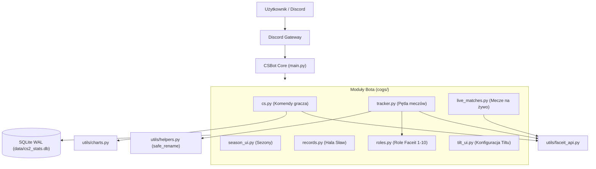

# Architektura Systemu

Dokumentacja techniczna architektury bota Discord do monitorowania statystyk Counter-Strike 2 z platformy Faceit.

---

## 1. Przepływ komponentów

Bot opiera się na bibliotece Discord.py 2.x w architekturze modułowej (Cogs) z asynchroniczną pętlą zdarzeń `asyncio` oraz lokalną bazą danych SQLite w trybie WAL.



---

## 2. Podział odpowiedzialności modułów (`cogs/`)

| Plik | Klasa Coga | Zakres odpowiedzialności |
| :--- | :--- | :--- |
| `cogs/cs.py` | `CSCog` | Komendy użytkownika: statystyki, wykresy, porównania 1v1, rankingi, linkowanie kont. |
| `cogs/tracker.py` | `FaceitTrackerCog` | Zadanie cykliczne (`tasks.loop(seconds=60)`) monitorujące zakończone mecze i wysyłające podsumowania na Discord. |
| `cogs/live_matches.py` | `LiveMatchesCog` | Monitorowanie trwających meczów i dashboard ze stanem rozgrywki w czasie rzeczywistym. |
| `cogs/season_ui.py` | `SeasonUICog` | Cykl życia sezonów: start/stop, tabele wyników i przypisywanie nagród MVP. |
| `cogs/records.py` | `RecordsCog` | Hala sław: obliczanie i prezentowanie serwerowych rekordów meczowych. |
| `cogs/roles.py` | `FaceitRolesCog` | Tworzenie oraz przydzielanie ról Faceit Level 1–10 na podstawie aktualnej rangi gracza. |
| `cogs/tilt_ui.py` | `TiltUICog` | Interfejs wyboru progu alertów dla serii porażek (Tilt-Meter). |

---

## 3. Komendy hybrydowe (Hybrid Commands)

Wszystkie komendy zaimplementowano jako hybrydowe (`@commands.hybrid_command` lub `@commands.hybrid_group`):
* Komenda może zostać uruchomiona przez prefiks tekstowy (np. `!stats`) lub natywny interfejs Slash Discorda (np. `/stats`).
* **Wczesne odroczenie odpowiedzi (`await ctx.defer()`)**: Discord wymaga potwierdzenia interakcji w czasie poniżej 3 sekund. Operacje sieciowe (Faceit API) oraz generowanie wykresów trwają od 1 do 3 sekund, dlatego komendy hybrydowe od razu wywołują `ctx.defer()`.
* **Rejestracja komend (`!sync`)**: Drzewo poleceń aplikacji jest synchronizowane z Discord API za pomocą komendy `!sync` (per serwer lub z flagą `global`).
* **Ograniczenia dostępu**: Komendy administracyjne posiadają `@discord.app_commands.default_permissions(administrator=True)`, co pozwala Discordowi ukrywać je w menu aplikacji przed użytkownikami bez uprawnień administratora.

---

## 4. Asynchroniczność i izolacja operacji blokujących

Główny wątek pętli `asyncio` obsługuje komunikację z Discord Gateway. Operacje blokujące są delegowane poza pętlę zdarzeń:

### Renderowanie wykresów (`utils/charts.py`)
Generowanie wykresów z biblioteką Matplotlib obciąża procesor i blokuje wykonanie kodu:
1. Obliczenia i eksport do bufora pamięci są przekazywane do puli wątków:
   ```python
   buf = await asyncio.to_thread(generuj_wykres_elo, nick, mecze)
   ```
2. Każda figura jest zwalniana w bloku `finally`, zapobiegając wyciekom pamięci w długo działającym procesie:
   ```python
   fig, ax = plt.subplots(figsize=(10, 5))
   try:
       # generowanie wykresu
   finally:
       plt.close(fig)
   ```

### Operacje bazodanowe (`utils/db_sqlite.py`)
Baza działa w trybie **WAL (Write-Ahead Logging)**, co umożliwia równoległy odczyt bez blokowania transakcji zapisu. Połączenia są zamykane w menedżerach kontekstu (`with get_connection()`).

---

## 5. Integracja z Faceit API i limity zapytań

Komunikacja z Faceit jest podzielona na dwa kanały w `utils/faceit_api.py`:

1. **Oficjalne Faceit Data API (REST)**:
   * Wykorzystywane do pobierania profili, historii meczów i szczegółowych statystyk rund.
   * Wymaga klucza w nagłówku `Authorization: Bearer {FACEIT_API_KEY}`.
   * Błędy 429 i 5xx są obsługiwane z mechanizmem ponawiania zapytań (backoff).

2. **Faceit Live API (curl_cffi)**:
   * Wykorzystywane do sprawdzania stanu trwających rozgrywek.
   * Używa `curl_cffi` z impersonacją przeglądarki Chrome w celu uniknięcia blokad Cloudflare TLS fingerprinting.
   * W razie odpowiedzi 403 błąd jest logowany na poziomie `DEBUG`, a moduł wraca do standardowego API.

3. **Limit edycji nazw kanałów na Discordzie (`utils/helpers.py`)**:
   * Discord nakłada limit maksymalnie 2 edycji nazwy tego samego kanału w ciągu 10 minut.
   * `safe_rename_channel` rejestruje znaczniki czasu wykonanych zmian w pamięci procesu i wstrzymuje żądania naruszające limit.

---

## 6. Logowanie

Aplikacja korzysta z modułu `logging` skonfigurowanego w `main.py`:
* `StreamHandler`: wypisywanie zdarzeń na konsolę (stdout).
* `RotatingFileHandler`: zapis do pliku `data/bot.log` z limitem 5 MB na plik i rotacją do 3 plików archiwalnych.
