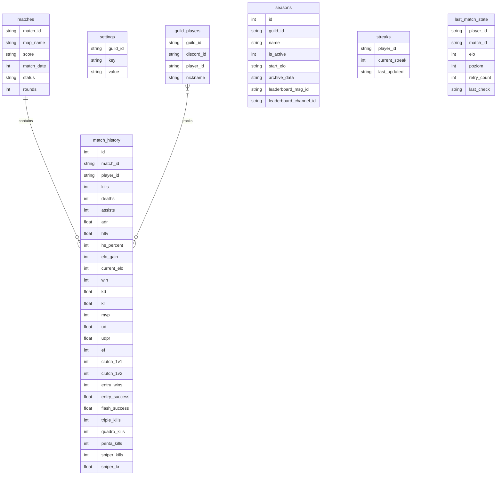

# Schemat Bazy Danych

Dokumentacja techniczna struktury danych SQLite w bocie CS2 Faceit Tracker.

---

## 1. Parametry bazy danych

* **Plik**: `data/cs2_stats.db`
* **Silnik**: SQLite 3 (`sqlite3`)
* **Dziennik transakcji**: `WAL` (Write-Ahead Logging) — pozwala na równoległe odczyty w trakcie zapisu:
  ```sql
  PRAGMA journal_mode = WAL;
  PRAGMA synchronous = NORMAL;
  ```
* **Timeout blokady**: `15.0s` — zapobiega błędom `database is locked` przy jednoczesnych zapytaniach.
* **Format wierszy**: `conn.row_factory = sqlite3.Row` (dostęp po nazwach kolumn).

---

## 2. Diagram relacji (ERD)



### Relacje tabel (tekstowa mapa powiązań)

```text
[ guild_players ] (guild_id, discord_id, player_id)
        │
        └── (player_id) ────┐
                            ▼
[ matches ] (match_id) ──> [ match_history ] (match_id, player_id)
                                    ▲
[ streaks ] (player_id) ────────────┤
[ last_match_state ] (player_id) ───┘

[ settings ] (guild_id, key) ───────> konfiguracja per-serwer
[ seasons ] (guild_id, id) ─────────> sezony i archiwum wyników per-serwer
```

---

## 3. Tabele

### `guild_players`
Powiązania kont Discord z identyfikatorami Faceit dla poszczególnych serwerów.
* `guild_id` (TEXT, PK): Identyfikator serwera Discord.
* `discord_id` (TEXT, PK): Identyfikator użytkownika Discord.
* `player_id` (TEXT): Identyfikator UUID gracza na platformie Faceit.
* `nickname` (TEXT): Nick gracza w Faceit w chwili powiązania.
* **Indeksy**: `idx_players_guild (guild_id)`, `idx_players_pid (player_id)`.

---

### `matches`
Zarejestrowane spotkania Faceit.
* `match_id` (TEXT, PK): Unikalny identyfikator meczu Faceit.
* `map_name` (TEXT): Nazwa mapy (np. `de_mirage`).
* `score` (TEXT): Wynik meczu (np. `13 / 9`).
* `match_date` (INTEGER / DATETIME): Znacznik czasu zakończenia meczu (Unix timestamp).
* `status` (TEXT): Status spotkania (`finished`).
* `rounds` (INTEGER): Liczba rozegranych rund.

---

### `match_history`
Szczegółowe statystyki graczy z poszczególnych meczów.
* `id` (INTEGER, PK AUTOINCREMENT): Identyfikator rekordu.
* `match_id` (TEXT, FK): Relacja do tabeli `matches`.
* `player_id` (TEXT): Identyfikator UUID gracza Faceit.
* `kills`, `deaths`, `assists` (INTEGER): Liczba eliminacji, zgonów i asyst.
* `adr` (REAL): Średnie obrażenia na rundę.
* `hltv` (REAL): Rating HLTV 2.0.
* `hs_percent` (INTEGER): Procent trafień w głowę.
* `elo_gain` (INTEGER): Zmiana punktów ELO po meczu (+/-).
* `current_elo` (INTEGER): Liczba punktów ELO po zakończeniu meczu.
* `win` (INTEGER): Flaga wyniku: `1` (zwycięstwo), `0` (porażka).
* `kd` (REAL), `kr` (REAL): Współczynniki eliminacji do zgonów i eliminacji na rundę.
* `mvp` (INTEGER): Liczba tytułów MVP w meczu.
* `ud` (REAL), `udpr` (REAL): Całkowite obrażenia od granatów i średnia na rundę.
* `ef` (INTEGER): Liczba oślepionych przeciwników (Enemies Flashed).
* `clutch_1v1`, `clutch_1v2` (INTEGER): Liczba wygranych pojedynków clutch.
* `entry_wins`, `entry_success` (REAL): Liczba i skuteczność otwarć rund (First Kills).
* `triple_kills`, `quadro_kills`, `penta_kills` (INTEGER): Liczba rund z wieloma zabójstwami.
* `sniper_kills`, `sniper_kr` (REAL): Zabójstwa z broni snajperskich i średnia na rundę.
* **Indeksy**: `idx_history_pid (player_id)`, `idx_history_unique UNIQUE (match_id, player_id)` (zapobiega duplikatom wpisów z jednego meczu).

---

### `settings`
Konfiguracja parametrów bota per serwer Discord w formacie klucz-wartość (JSON).
* `guild_id` (TEXT, PK): Identyfikator serwera Discord.
* `key` (TEXT, PK): Nazwa parametru (np. `prefix`, `main_channel`, `main_color`, `faceit_roles`).
* `value` (TEXT): Wartość zserializowana do JSON.
* **Indeksy**: `idx_settings_guild (guild_id)`.

---

### `seasons`
Lokalne sezony rankingowe serwera.
* `id` (INTEGER, PK AUTOINCREMENT): Numer sezonu.
* `guild_id` (TEXT): Identyfikator serwera.
* `name` (TEXT): Nazwa sezonu.
* `is_active` (INTEGER): Flaga aktywności: `1` (aktywny), `0` (zakończony).
* `start_elo` (TEXT JSON): Mapa `{player_id: elo}` z momentu rozpoczęcia sezonu.
* `archive_data` (TEXT JSON): Zrzut wyników i wyłoniony MVP po zakończeniu sezonu.
* `leaderboard_msg_id` (TEXT): ID wiadomości Discord z tabelą wyników.
* `leaderboard_channel_id` (TEXT): ID kanału Discord, na którym umieszczono tabelę.

---

### `streaks`
Serie wygranych lub przegranych spotkań.
* `player_id` (TEXT, PK): UUID gracza Faceit.
* `current_streak` (INTEGER): Wartość dodatnia (seria wygranych) lub ujemna (seria porażek).
* `last_updated` (DATETIME): Czas ostatniej aktualizacji passy.

---

### `last_match_state`
Rejestr stanu ostatnio sprawdzonego meczu na potrzeby pętli śledzącej.
* `player_id` (TEXT, PK): UUID gracza Faceit.
* `match_id` (TEXT): Identyfikator ostatniego przetworzonego meczu.
* `elo` (INTEGER): Ostatnia odnotowana wartość ELO.
* `poziom` (INTEGER): Ostatni odnotowany poziom (1–10).
* `retry_count` (INTEGER): Licznik ponowień przy oczekiwaniu na pełne statystyki meczu.
* `last_check` (DATETIME): Czas ostatniego odpytania API.

---

## 4. Odczyt konfiguracji (`get_cfg`)

Funkcja `get_cfg(guild_id, key, default)` w `utils/database.py` działa dwuetapowo:
1. Sprawdza tabelę `settings` w bazie danych dla podanego serwera (z wykorzystaniem pamięci podręcznej `_settings_cache`).
2. Jeśli wartość nie jest zdefiniowana w bazie, zwraca wartość domyślną z pliku `config.py`.
3. Zapis wartości za pomocą `zapisz_ustawienia()` unieważnia pamięć podręczną dla danej gildii.

---

## 5. Utrzymanie i kopia zapasowa

* Funkcja `init_db()` wywoływana przy starcie bota sprawdza schemat i uruchamia `migrate_schema()` w sposób bezpieczny dla istniejących danych.
* **Kopia zapasowa**: W trybie WAL należy kopiować plik główny razem z plikami dziennika pomocniczego:
  ```bash
  cp data/cs2_stats.db data/cs2_stats.db-wal data/cs2_stats.db-shm /sciezka/do/kopii/
  ```
  Lub skorzystać z procedury online w SQLite:
  ```bash
  sqlite3 data/cs2_stats.db ".backup 'data/backup_cs2_stats.db'"
  ```
